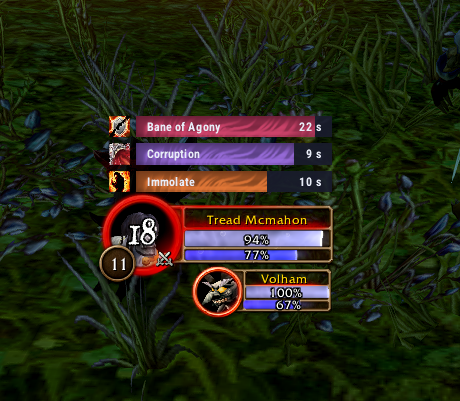
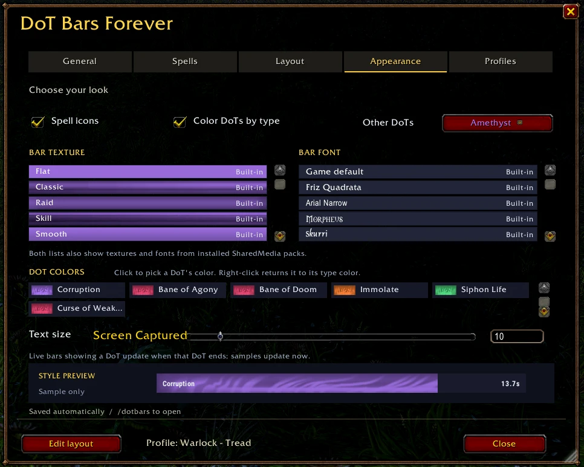

# DoT Bars Forever

Clean, minimal bars for **your own damage-over-time spells** in **WoW Forever** (interface 16001), tracked separately on your target, your target's target, and your focus. Only DoTs that are actually ticking appear: no placeholders.

<p align="center">
  
</p>

<p align="center">
  
</p>

## Features

- **Class presets:** your class's DoTs are filled in automatically on first load, including all ranks. Add custom DoTs by aura ID.
- **Spell tray:** a bar of slots; drag spells in from your spellbook or action bars. Slot edits preserve independent positions; use Arrange by slot order when you want to rearrange them.
- **Layouts:** stacked bars (growing up or down, ordered by cast) or independently placed bars; move and resize them in layout editing; copy one unit's layout to the others.
- **Colors:** each DoT by type: curses/banes, life drains, then spell school (shadow, fire, nature, arcane, frost, holy, physical), with per-spell overrides on the Appearance page.
- **Look:** seven built-in bar textures (including original Smooth, Glass and Gloss), game fonts, and any bar textures or fonts from installed SharedMedia packs.
- **Options window:** top tabs and a lower-right grip that scales the entire window, and scale saved per character.
- **Profiles:** separate class-character defaults (for example Warlock - Tread), with optional explicit sharing; create, copy, reset and switch.
- Minimap button, `/dotbars` slash command, and an entry in the game's AddOns settings.

## Install

Download the latest ZIP from [Releases](https://github.com/t0ddharris/DoT-Bars-Forever/releases/latest), extract the `DoTBarsForever` folder into `World of Warcraft/_forever_/Interface/AddOns/`, restart the game, then type `/dotbars`.

Formerly named *Just DoT Timer*: if you used it, delete the old `JustDoTTimer` folder. Its settings do not carry over.

## Status

Version 0.3.0. Lua syntax and 256 simulated assertions pass. Confirmed in game: per-character profiles, colors by DoT type on live bars, and the Appearance tab. Tab hover and corner-grip scaling still need an in-game check.

Live bars use the client's own duration fill. Because the game locks live aura bars to addon code, effects such as Smooth Animated Bars' liquid can't be applied to them, and style changes reach a live bar when its DoT ends ([details](docs/GUIDE.md)).

## Development

- `DoTBarsForever/`: the addon itself.
- `development/`: build scripts, texture generator and tests.
- `docs/`: [guide](docs/GUIDE.md), [testing checklist](docs/TESTING.md), [requirements](docs/REQUIREMENTS.md), [implementation matrix](docs/IMPLEMENTATION-MATRIX.md).

```text
npm --prefix development ci --ignore-scripts --cache development/.npm-cache
npm --prefix development test
powershell -File development/scripts/package.ps1
```

The package script reads the version from `DoTBarsForever/DoTBarsForever.toc` and writes `releases/DoTBarsForever-<version>.zip`.

## License

[MIT](LICENSE). Adapted spell rank data from Dyre's Debuff Tracker (MIT) is credited in `DoTBarsForever/THIRD_PARTY_NOTICES.md`.
